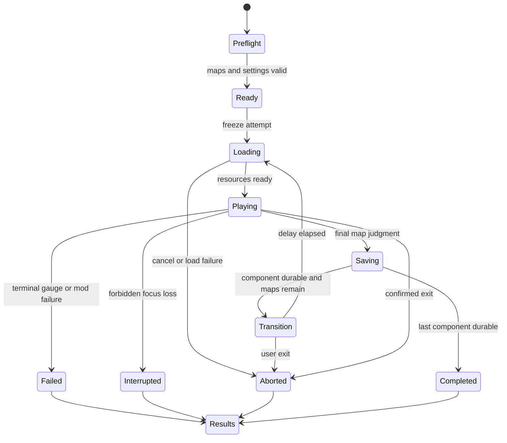

# Skill Course client implementation plan

Implement courses as a separate persisted domain that coordinates the existing single-map engine. Reuse the collection manager interaction, mod models, map library, gameplay loader, and result-screen presentation. Keep the active course attempt outside `StatisticV2` so native per-map scores and replays remain intact.

The [23 November UI and preferences revision](UI_AND_PREFERENCES_REVISION.md) supersedes the earlier result, breakdown and preflight UI below and is required before C5 completion. Allowed mods remain course-wide.

The [shared contract](SHARED_CONTRACT.md) defines proposed v1 JSON, gauges, scoring, timing, and mod semantics. The [server plan](SERVER_IMPLEMENTATION_PLAN.md) defines the corresponding upload API. The [testing plan](TESTING_PLAN.md) is the acceptance checklist for each milestone.

C5 is the complete offline MVP. C1 through C5 may be implemented and accepted entirely with JVM/Robolectric tests and AVDs; no course backend change, live course API, global course leaderboard, score submission or physical-device access is a dependency. Existing mirror downloads are optional map-recovery infrastructure, not the future course server. C6 introduces both server integration and its separately required real-device ADB acceptance gate. The detailed [map availability and recovery plan](MAP_AVAILABILITY_AND_RECOVERY.md) is part of C2/C3 and must be finished by C5.

## Existing implementation and integration seams

Paths below are relative to the client repository. Symbols identify the seam more reliably than line numbers while existing work is in progress.

| Existing code | Relevant behavior and planned extension |
| --- | --- |
| `src/com/osudroid/data/BeatmapCollections.kt` | Collection membership uses `setDirectory`, not difficulty MD5 or ordered map instances. Follow its DAO conventions; create separate course entities. |
| `src/com/edlplan/ui/fragment/CollectionsManagerFragment.java` | RecyclerView manager, add/remove adapter, create and delete interactions. Reuse presentation patterns, not its folder membership semantics. |
| `res/layout/collections_fragment.xml`, `collections_item.xml` | Existing manager body is 500dp wide; add dedicated responsive course layouts with more room. |
| `src/com/edlplan/ui/fragment/BeatmapPropertiesFragment.kt` | `manageFavButton` captures the current selection's set directory. Add Manage course, capturing the exact selected difficulty and a deep copy of mods. |
| `src/ru/nsu/ccfit/zuev/osu/menu/BeatmapItem.java` and `BeatmapSetItem.java` | Long press delegates through the parent set. Course actions must retain the actual difficulty, not default to the first map. `applyFilter` and child expansion need exact MD5 filtering. |
| `src/ru/nsu/ccfit/zuev/osu/menu/SongMenu.java` | `setFilter` currently limits sets; `selectBeatmap` can start a second-tap selection; `toggleScoringSwitcher` uses local/online booleans. Add explicit practice context and a third board mode. |
| `src/com/osudroid/data/Beatmaps.kt` | BeatmapInfo provides MD5, metadata, object counts, difficulty ID and set ID. Resolve by MD5 and verify the actual `.osu` before starting. |
| `BeatmapDownloader.kt`, `MainActivity.loadBeatmapLibrary`, `LibraryManager.scanDirectory`, `FileUtils.extractBeatmapset` | Single-download ownership, archive extraction, forced-directory refresh and DB reconciliation need typed completion; ordinary reload can skip existing folders and leave renamed difficulty rows. See the recovery plan for exact source constraints and safe update steps. |
| `src/com/osudroid/mods/APIMod.kt`, `src/com/osudroid/utils/Mods.kt`, `ModHashMap.kt` | Existing acronym/settings serialization, `deepCopy`, compatibility handling. Course validation must reject unknown or clamped settings before normal conversion. |
| `src/ru/nsu/ccfit/zuev/osu/MainActivity.java` | `parseIntent`, `onNewIntent`, `copyContentUriToCache`, and pending import handling route existing archives/replays. `.odc` must be classified before archive processing. |
| `src/com/osudroid/ui/v2/GameLoaderScene.kt` | Current minimum loading/fade timeout is 2000ms for a new map and 500ms for restart. Add a course load policy so transition 0 is not forced to wait for normal loader UX. `cancel` must terminate an active course load. |
| `src/ru/nsu/ccfit/zuev/osu/game/GameScene.java` | `startGame`, `prepareScene`, `registerHit`, circle/slider/spinner listeners, HP drain in `onUpdate`, `pause`, `gameover`, `quit`, and final replay/results handoff need explicit course hooks. |
| `src/ru/nsu/ccfit/zuev/osu/game/GameplaySlider.java` | `onSliderHit` overloads nested misses and final judgment; tail tracking/award state must be exported explicitly for custom event policies. |
| `src/ru/nsu/ccfit/zuev/osu/scoring/StatisticV2.java` | Native score, combo, HP, judgment counts, ScoreV2, persistence. HP mutation also changes lives/alive state; global HP needs its own authority. |
| `src/com/osudroid/ui/v2/hud/elements/HUDHealthBar.kt` | Reads `game.stat.hp`; route a normalized course HP view without running native HP side effects. Add course progress, course metric and optional timer. |
| `src/ru/nsu/ccfit/zuev/osu/scoring/ScoringScene.java` | `load` both renders and saves/submits a single-map score. Add an explicit course result entry point and read-only component view. |
| `src/com/osudroid/data/Scores.kt`, `Replay.java` | Existing per-map scores and `.odr` replays; preserve these formats and reference components from a course attempt. |
| `src/ru/nsu/ccfit/zuev/osu/online/OnlineManager.java`, `OnlineScoring.java` | Single-map submit API. Add a separate course API and upload flow; never send the aggregate to legacy `sendRecord`. |

The requested restoration removes the two unconditional `stat.canFail = false` setup assignments. The existing `StatisticV2.canFail = true` default remains. Future `none` and `global` course policies must set their own explicit behavior without disabling failure for ordinary play.

## Domain boundaries

Place new course models and services under `src/com/osudroid/skillcourse/` in Kotlin. Proposed responsibilities:

| Component | Responsibility |
| --- | --- |
| `CourseDefinitionV1`, `CourseMapV1`, settings DTOs | Serializable, immutable portable data; no Activity, installed paths, or official flags |
| `CourseCodec`, `CourseValidator`, `CourseHasher` | Bounded decoding, structural and semantic validation, deterministic export/hash |
| `CourseRepository` | Transactional local drafts, frozen definitions, lock state, map resolution, attempts and upload state |
| `CourseAvailabilityScanner`, `CourseMapRecoveryQueue` | Derived exact/outdated/missing state after imports, one-at-a-time mirror repair, and shared-import completion/rescan; complete by C3 |
| `CourseImportService`, `CourseExportService` | Android URI and stream boundaries; no UI thread parsing or implicit network downloads |
| `CoursePracticeContext` | Selected course filter, saved song-menu state, automatic authored mods, practice selection identity |
| `CoursePreflight` | C1-C5: exact maps, required mods, player additions, speeds and storage availability, entirely local; optional server capability/ticket checks are C6-only and cannot block local play |
| `CourseRunCoordinator` | One active attempt, frozen order/configuration, state transitions, completion idempotence, terminal cleanup |
| `CourseJudgmentSink`, `CourseGauge`, `CourseScoreAccumulator`, `CourseTimer` | Pure deterministic policies; receive semantic events and a controllable clock |
| `CourseResult`, `CourseComponentResult` | Aggregate and immutable native component snapshots; independent of `StatisticV2` lifetime |
| `CourseApi`, `CourseUploadQueue` | C6 only: capability lookup, verification, resumable component uploads and idempotent finalization |

These are proposed responsibilities, not a requirement to create one file per row. Keep the small interfaces injectable for tests and Java-callable where legacy GameScene calls them. Do not replace the entire gameplay architecture to introduce this feature.

## Room data and file durability

The current database version is `5`, with migrations in `src/com/osudroid/data/Migrations.kt`, schema exports under `schemas/`, and DAO access through `DatabaseManager`. Add migration `5 -> 6` if no intervening migration has landed; use the next free version at implementation time. Follow `BackedUpMigration` and the existing schema-export workflow.

Proposed tables:

- `SkillCourse`: local stable ID, canonical definition snapshot/hash, name/author summaries, local lock, draft state, timestamps. Imported definitions default locked; new courses default unlocked. Lock state is not exported or hashed.
- `SkillCourseMap`: course ID plus ordinal, map MD5, object counts and serialized APIMod data. Store or derive other metadata from the immutable manifest, with one authoritative representation and transactional updates. Do not use `setDirectory` as identity. An MD5 index can help resolution; revalidate file bytes because current BeatmapInfo has no MD5 uniqueness guarantee.
- `SkillCourseAttempt`: attempt ID, immutable definition snapshot/hash, ruleset version, outcome, realized permutation, player identity snapshot, selected mods/rates, aggregate statistics, active duration, and local completion time.
- `SkillCourseComponent`: attempt ID plus played index, original index, native statistics, six event counts, HP endpoints, effective mods, replay and sidecar references/digests, and terminal reason.
- `SkillCourseUpload`: attempt ID, account ownership, server ID/ticket, acknowledged replay indices/digests, retry state/time, and last structured error. A single writer claims an attempt; credential material stays in existing account storage.

The upload table/worker and account-dependent operations may be added by a later C6 migration; they are not a C1/C5 completion requirement. Store the immutable local attempt/evidence fields needed for future uploads now. Store availability as generation-tagged local derived state, or rebuild it from library snapshots; it does not modify the portable manifest.

The local attempt ID is the wire `client_attempt_id`. Store `server_attempt_id` separately only after registration; use it for component URLs and remote detail links. Offline sidecars bind the client ID, while server receipts and the finalized signed envelope bind both. Never generate a new client ID merely because an upload response was lost.

Keep course results outside ordinary `ScoreInfo` unless a component legitimately qualifies as an independent ordinary score. Proposal for v1: full-course components are persisted only under their attempt, avoiding implicit individual uploads and custom-gauge contamination. Practice uses ordinary per-map behavior and may save ordinary scores if otherwise eligible.

Persist replays under a private course-attempt directory with generated identifiers, not course/map titles as filenames. Write each replay and evidence sidecar to temporary files, calculate their digests, atomically rename within the same filesystem, then commit component references. Do not advance on a failed save. Retain only one active map's engine resources and release replay buffers after flushing. Reconcile unreferenced staging files at startup after an age threshold; never remove evidence referenced by saved or queued attempts.

Mark active attempts interrupted after process death. Keep completed components and any saved partial component; do not silently resume an official run. Deleting a course removes its manager entry but should retain local historical attempts by immutable snapshot, subject to a separate user-visible history deletion action.

## Import and export

### Opening an odc file

1. Add labeled `.odc` ACTION_VIEW intent filters for file/content URIs and appropriate JSON, octet-stream, and custom MIME types. Proposed MIME: `application/vnd.osudroid.course+json`. Keep existing beatmap, skin, replay, and invite handlers working.
2. Add an in-game Import course action using `ACTION_OPEN_DOCUMENT`. A provider may expose only an opaque document ID, so extension path matching alone cannot guarantee chooser discoverability. Test JSON/octet-stream providers and inspect `DISPLAY_NAME`, MIME, then bounded content. The [Android storage guide](https://developer.android.com/training/data-storage/shared/documents-files) describes URI-based document access and creation.
3. Copy a bounded stream into a uniquely named private staging file while URI permission is valid; handle null streams, denied permissions, provider failures and early EOF. Do not resolve arbitrary content URIs as filesystem paths or retain an unsafe provider filename.
4. Queue pending imports until database and menus are ready. A new import received during play must wait; it cannot replace the frozen course definition or trigger a scene switch.
5. Validate the full manifest, calculate hash, and insert the definition/maps in one transaction. Exact reimport is idempotent and must not silently reset a user's local lock state. Same name with a different hash creates a distinct course or a clearly identified revision choice.
6. Trigger a course availability scan after committing the import and show locked status plus per-map missing/outdated issues. Also subscribe to the common beatmap-import-completed event, emitted only after file/Room reconciliation and library reload. In C6, official lookup may run asynchronously; C5 import never requires or calls it. Failed lookup means unavailable/unknown, not a fabricated definitive verdict.

Changing an unlocked imported course creates a new content hash and clears its cached official association. Invalidate the badge immediately, before a later verification request finishes. A lock prevents add/remove/reorder and rule edits, but not practice, play, export or deletion. Unlock changes local state only; actual edits change course identity. Deletion requires the existing confirmation interaction pattern.

### Exporting

Use `ACTION_CREATE_DOCUMENT` with a sanitized suggested filename ending in `.odc`. Serialize the portable definition, not local entity rows, official badges or file paths. Validate before export, close streams on cancellation or failure, and report success only after completion. Sharing may use the existing FileProvider with temporary URI permission. Round-trip must preserve the course hash. Export does not package copyrighted beatmaps or replays.

## Course manager and editor

Add Manage course to the selected difficulty's long-press properties. Also expose the course manager from song selection without requiring an installed map, so imported courses with missing maps remain reachable.

Use a dedicated BaseFragment/RecyclerView manager, following the existing manager's lifecycle and animation. Proposed width is up to 720dp bounded by available screen width and margins, wider than the current 500dp collection manager on suitable displays. Use a compact fallback on small phones rather than overflowing.

Each card presents name, author, map count, lock status and missing/outdated issue counts; add online verification status in C6. Keep three principal actions visible: membership add/remove when invoked for a map, View (eye), and Play. When any entry is unresolved, replace Play with Download missing maps, covering both missing and outdated revisions. List each unresolved map and its reason inside the manager. Keep that replacement action after unavailable/wrong-version download results, with manual-import guidance; restore Play only after a successful rescan. Put Lock/Unlock, Edit, Export and Delete behind the end kebab menu. Provide content descriptions, 48dp touch targets, readable disabled state, keyboard/focus order and truncation with a way to inspect full names.

- Membership add takes a deep snapshot of current mods at the action, updates count, and shows saved mods. Removal matches MD5 regardless of the currently selected mods. Locked membership controls are disabled with an explanation.
- `+ Create new course` opens the same editor as Edit. Choose author from the current online name when logged in, otherwise the configured local player name; author is editable display text, not authenticated ownership. Creation from a map context proposes adding that map on Save and shows that choice; cancel writes nothing.
- Editor sections: identity; gauge/scoring selectors; compact event table; pause/skip/order/transition; speedrun and allowed mods; ordered maps. Show global gauge controls only for global, and EX controls only for EX. Preserve inactive values internally.
- Use the six events as rows with HP and EX inputs in compact columns when both groups are active. Label maximum/starting HP separately. Numeric inputs accept signed deltas and show inline bounds/errors; localized UI numbers serialize invariant JSON.
- Provide reorder controls or drag handles with a keyboard-accessible alternative. Save validates the entire snapshot and updates it transactionally; Cancel preserves the old definition. Disable edits to an active run's frozen snapshot.
- Empty drafts have create/add guidance, disabled Play/Export and a useful explanation. Importing, verifying and downloading show progress/cancellation; failed operations retain the existing saved definition.

## Viewing and practicing

Entering View captures current filters, search, sort/grouping, selected map, leaderboard mode and mods. Resolve entries using the availability snapshot: exact installed maps for Ready and visibly labeled metadata-matching candidates for Outdated. Missing entries are omitted without removing them from the definition. Apply the resulting explicit difficulty filter to both set visibility and child creation; do not pass an empty set limit to existing `applyFilter`, where an empty limit currently means unrestricted sets. An all-missing course shows an empty course view with recovery guidance. No unrelated sibling difficulty may leak into the list.

Selecting a map applies a deep copy of its authored mods before difficulty calculation, UI refresh or gameplay start. Guard the existing second-tap start path and asynchronous calculation jobs so the previous map's mods cannot race into the next selection. Display authored course position, saved mods and missing state. For v1 unique-map membership, a selected MD5 resolves one course entry.

Practice starts a normal single-map session with those mods and ordinary map rules. An outdated installed candidate may be practiced with a clear wrong-revision label, but cannot satisfy the authored hash or advance a course. Practice does not create/advance a course attempt or carry global HP/accuracy. Return to course view afterward. Exiting View restores the captured song-menu state; queued stale leaderboard or mod calculations cannot overwrite the restored state.

In C6, replace the local/online boolean at the song-menu boundary with `LOCAL_MAP`, `ONLINE_MAP`, and `COURSE` modes, adapting ScoreBoard without changing existing map behavior. `COURSE` is present only in course view with backend capability and queries the course hash independently of selected difficulty. Show loading, no scores, cached/offline and failure states; clear results when changing course. Tapping an entry uses the server attempt ID, not the old per-map `playID = uid` convention. C3/C5 require neither this extra global mode nor a fake empty server board; local course history remains available through results/history.

## Preflight and run state

Preflight must finish before the first playable map:

1. Validate definition, all mods/settings, incompatible fail controls and ScoreV2 policy.
2. Scan every entry: Ready requires exact MD5/counts; Outdated means only the artist/title/mapper/difficulty tuple matches; Missing means neither matches. Keep View enabled and omit missing entries from its song list. Replace manager Play with Download missing maps until every entry is Ready. Use the configured existing mirror to resolve difficulty IDs, deduplicate by parent set, and download/import one set at a time. Stage and validate the required revision, safely overwrite/reconcile unambiguous outdated targets, then publish the import completion and rescan. Wrong/unavailable revisions retain the download action and manual-import guidance. Follow the recovery plan for file journal/rollback, forced DB refresh, renamed keys and sibling preservation.
3. Present per-map speeds for speedrun and allowed additional mods. Validate additions against every map, show exact effective mods, and freeze selections. No selection dialog between maps.
4. Check sufficient storage, audio/assets, and mutually exclusive contexts such as multiplayer, replay playback and HUD editing. Do not simulate a course by setting `Multiplayer.isMultiplayer`.
5. Freeze a course snapshot, attempt ID, explicit permutation, ruleset and initial HP. Through C5 this is entirely local, with no login, ticket or server-capability prerequisite. In C6, obtain an optional ticket if the chosen official policy requires it, while retaining the local/offline path.

Coordinator mutations execute on the engine update thread. IO and network work return immutable completion messages with attempt/generation identifiers; discard stale completions after cancel or scene teardown.

Persist partial failure evidence before showing results when possible. Terminal states stop the timer and HP updates, invalidate callbacks, cancel pending transitions, and restore song-menu/mod/audio/touch options exactly once. A result-save failure stays visibly recoverable and cannot masquerade as successful completion.

## Gameplay integration

### Component completion and transitions

Extract the existing end-of-map save/cleanup handoff into an immutable completion notification that can choose ordinary results or course coordination. Intermediate maps must save their replay and native score before advancing, bypassing ScoringScene's current ordinary submit path. Send failure, quit and loader cancellation through the same terminal ownership rules.

Use GameLoaderScene with a course load policy. When transition is zero, proceed as soon as component evidence and required resources are ready; eliminate the default minimum display timeout for that policy. For nonzero transitions, propose starting the delay at the last judgment, overlapping save/load where safe, then starting when both the delay and resources are ready. Loading may make the actual gap longer. Do not bypass native resource cleanup or let a load happen twice. Avoid preloading full maps until profiling establishes a need; cancellation correctness comes first.

Use existing `skip` behavior once after the map is ready, before the active timer starts, when `auto_skip` is enabled. Preserve gameplay's safe skip boundary and replay timing. Define manual-skip policy with the shared contract rather than allowing speedrun players to choose an unrecorded shortcut. Do not count the existing completion lead-out as active speedrun time.

### Judgments and HP

Introduce semantic events at the live judgment source, not only in `StatisticV2.registerHit`: that method combines spinner bonuses, slider nested scoring, normal HP and final judgments. Emit final circle/slider/spinner judgments once and explicit nested failures/tail misses from GameplaySlider. Version and persist the event evidence for server verification.

Add a narrow HP policy seam around both native judgment HP mutation and passive drain. Ordinary gameplay delegates to its existing behavior; standard courses reset normal HP per map; none ignores fail; global owns integer HP and bypasses all native HP gain/drain/life mutations. Do not simply copy ending `stat.hp` into a newly constructed statistic because `prepareScene` currently replaces it and `changeHp` has side effects. Initialize the course gauge after map setup and before the first event. HUD consumes normalized `currentHp / totalHp` from the selected policy.

Route all failure paths, including Perfect and Sudden Death, through the coordinator. Never allow those existing automatic restarts to replay only one component within a full course. Avoid the normal Retry menu on a course failure; full-course Retry creates a new attempt, resets HP and total statistics, and reshuffles if configured.

### Scoring and timing

Keep a fresh native StatisticV2 per map. For score modes, snapshot `getTotalScoreWithMultiplier()` using the matching native mode. For EX, accumulate signed event deltas across the entire course and floor only the final published result at zero: `max(0, rawExTotal)`. Do not floor after events or sum separately floored map scores. Keep signed component contributions and `raw_ex_total` for detail/verification. For accuracy, accumulate integer judgment counts and compute the pooled ratio. Do not carry native combo across maps. Preserve raw native scores and mod multipliers for auditing; account for this fork's separate ScoreV2 accumulator and display getter rather than copying an upstream formula.

Signed running EX display is a small course-specific UI change: HUDScoreCounter already formats a signed Long, but SpriteFont does not map `-`, and legacy ScoreNumber maps unsupported characters to `x`. Put a font-rendered minus sign beside the existing digit rendering for the course EX counter, or use the existing UIText numeric text path with a working minus glyph. Reuse the same signed formatter in component detail; do not require every skin to supply a new texture or refactor ordinary score rendering. The final course EX total is nonnegative. Tests must cover sign changes and negative contributions under a skin with no minus asset.

Drive the speedrun timer with a monotonic clock around actual active gameplay. Stop at the semantic last-object event rather than at delayed results creation. Exclude loading/transitions and allowed pauses; include in-map breaks and active stalls. Record boundaries and selected effective rate for each component. No per-frame database or network work; batch event evidence and flush at bounded intervals or component completion.

## Pause, interruption and cleanup

For `allow_pause = false`, guard manual pause/back with the multiplayer-style exit confirmation and keep all course state independent of multiplayer room globals. MainActivity focus-loss/background callbacks must notify course policy before normal pause dispatch. Recommended no-pause behavior is a terminal interruption; normal engine/audio suspension still happens for Android lifecycle safety.

For pause-allowed runs, preserve coordinator state and timer suspension across the normal pause overlay, without granting component retry. Process death, force-stop, account change, unrecoverable load error, map deletion during a run and replay-save failure need explicit outcomes. A restarted app can inspect saved history and retry uploads; it must not resume a frozen ranked run using only the last persisted total.

## Result screen and component panel

Add `ScoringScene.loadCourse(CourseResult)` or an equivalent typed adapter. Reuse scene assets/layout where appropriate and factor shared rendering so presentation is separate from saving/submission. Do not fake one BeatmapInfo or call ordinary `load` with an aggregate StatisticV2; its note-count validation, rank/PP calculation, replay assumptions, and upload side effects are map-specific.

Course results copy the ordinary beatmap result layout and its skin assets/ScoreNumber digits: summed native judgment counts (including 300G/100K), selected aggregate metric, pooled accuracy and largest component combo at the normal positions. Replace only the grade area with Completed/Failed and maps played immediately below it; keep speedrun active time in a compact secondary line. Remove the duplicate detailed verdict/reason block. Add server verification state in C6. Final EX is floored at zero while raw EX and component contributions remain signed; accuracy mode displays a percentage. Hide ordinary PP and one-map replay controls. Retry restarts the full course and Back restores course view.

Add a side Breakdown button opening the game's themed panel used from song selection, with one component page at a time and left/right chevrons in played order, following the supplied mockup. Do not use a generic Android AlertDialog for this breakdown. Each row contains played index, original course index when randomized, map metadata, effective mods/rate, native map score, course contribution, accuracy/judgments, combo, HP endpoints, active time if relevant, and pass/fail/unplayed state. Unplayed rows have no invented score. Row detail can show the existing single-map result presentation in an explicitly read-only mode and play that component's `.odr`; neither operation may insert or resubmit a score.

By C5, local results, component replays and history are fully usable after restart, without a submit step. In C6, add visible independently retryable upload/verification state; server failures do not erase evidence or change completed gameplay into a failed play.

## Network integration

This section is C6 work behind the server-change gate and real-device ADB acceptance gate. It must not block C1 through C5 implementation or AVD acceptance. Do not wire live capability, registry, submission or course leaderboard requests into the offline MVP.

Add course capability/version detection, registry lookup, leaderboard and detail requests, per-component evidence upload and finalization as described in the server plan. Reuse the existing OkHttp and account/session mechanisms, with a distinct API namespace and typed error parsing. Do not change `onlineVersion` merely to implement course schema versioning.

Queue uploads after local durability, keyed by a stable attempt ID and authenticated account. Reuse acknowledgments by component digest, honor Retry-After for throttling, back off temporary failures, wait for reauthentication on expiry, and stop retrying invalid evidence. Account switching cannot submit another player's queued attempt. Never delete queued replays automatically to satisfy a transient quota condition.

Attestation for the new endpoint must bind course hash, attempt identity, ordered evidence digests, effective mods/rates and totals; the current single-map signature payload does not. Treat server definition recognition, evidence receipt and final verified acceptance as separate states. Official badge lookup cannot mark an uploaded attempt verified by itself.

## Milestones and completion criteria

| Milestone | Scope | Exit criteria |
| --- | --- | --- |
| C1 Contract and storage | Codec, strict validation/hash, DTOs, Room migration and offline reference fixtures | Client vectors pass without a server runtime; old collections/scores survive migration; drafts and imports durable; AVD sufficient |
| C2 Import and management | Android association, import/export, cards/editor, locking/membership and post-import availability scan | Missing/outdated classifications and issue list correct; file-manager/picker round-trips; all checks possible on AVD |
| C3 View and map recovery | Resolved difficulty filtering, automatic mods, practice, sequential mirror repair and safe storage/DB updates | Missing entries omitted; outdated candidates labeled; wrong-version button retained; overwrites/renames reconcile rows; manual import rescans; AVD sufficient |
| C4 Course gameplay | Coordinator, events, all gauges/scoring, pause/skip/transitions, speeds/random order | Deterministic fixtures pass; fail/abort never advances; bounded memory and complete component evidence |
| C5 Offline MVP | Complete C1-C4 plus aggregate results, breakdown, per-map replay/history and offline acceptance | Fully functional offline course system passes JVM/Robolectric/AVD gates; signed running EX with final floor 0; no course submission/global leaderboard or physical-device dependency |
| C6 Server and device integration | Capability/registry, queue/uploads, finalization, global leaderboard/detail and real-device validation | Server-change gate: staging API/storage/verifier and parity tests pass; ADB gate: representative physical device passes actual-input end-to-end; retries/ownership correct; C5 offline path preserved |
| C7 Rollout acceptance | Final combined matrix, regression and deployment review | C6 gates and final release checks pass; does not defer any offline MVP functionality beyond C5 |

Keep unresolved product choices in the shared contract visible until decided. Freeze the offline rules needed for C5 first; server-only ranking/approval policy does not block the MVP. Execute TypeScript parity, backend integration and physical-device tests in C6, and keep official ranking disabled until its verifier passes acceptance.
